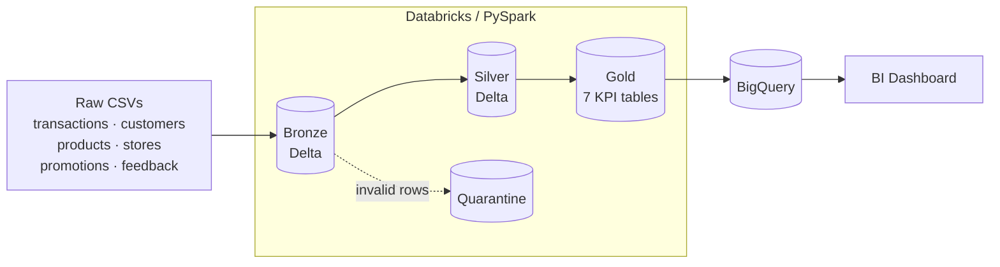

# 🛒 E-Commerce Sales Analytics Pipeline

An end-to-end data engineering project that turns raw retail CSV files into analytics-ready tables using a **medallion (bronze → silver → gold) architecture** on **Databricks, PySpark and Delta Lake**, loads the results into **BigQuery**, and serves them to a **BI dashboard**.


> **Note on data:** this project runs on a small sample retail dataset (100 transactions), so the focus is on engineering quality: schema enforcement, data validation, correctness testing and a documented bug fix. The same code is designed to scale to larger data.

---

## 📌 Table of Contents
- [Highlights](#-highlights)
- [Architecture](#-architecture)
- [Tech Stack](#-tech-stack)
- [Dataset](#-dataset)
- [Pipeline Layers](#-pipeline-layers)
- [Data Quality & Testing](#-data-quality--testing)
- [The Join Bug I Found and Fixed](#-the-join-bug-i-found-and-fixed)
- [Results & Insights](#-results--insights)
- [Dashboard](#-dashboard)
- [Repository Structure](#-repository-structure)
- [How to Run](#-how-to-run)
- [Security](#-security)
- [Future Improvements](#-future-improvements)
- [Author](#-author)

---

## ✨ Highlights

- **Medallion architecture** with Delta Lake: raw → bronze → silver → gold, all stored as Delta tables.
- **Explicit schemas** for all 6 source files, with lineage columns (`_source_file`, `_ingest_time`).
- **Resilient date parsing** across multiple formats (invalid values become NULL instead of crashing the job).
- **Quarantine table** for invalid records, so bad data is never silently dropped or zero-filled.
- **Join-safe enrichment:** feedback pre-aggregated, promotion date windows applied inside the join.
- **9 automated data-quality checks** that fail the run on any violation, including row-count reconciliation.
- **7 gold KPI tables** loaded into **BigQuery** for BI.
- **Independently verified:** net revenue cross-checked against a separate pandas calculation (exact match).

---

## 🏗 Architecture



| Layer | Purpose |
|---|---|
| **Bronze** | Raw data with enforced schema and lineage columns; no business logic. |
| **Silver** | Cleaned, deduplicated, validated and enriched transaction table (customer, product, store, promotion and feedback attributes). |
| **Gold** | Business-level aggregates ready for dashboards. |

---

## 🧰 Tech Stack

| Area | Tools |
|---|---|
| Processing | Databricks, PySpark, Spark SQL |
| Storage | Delta Lake, Unity Catalog Volumes |
| Warehouse | Google BigQuery (Spark BigQuery connector) |
| BI | Power BI / Looker Studio |
| Secrets | Databricks Secrets |
| Languages | Python, SQL, DAX |
| Version control | Git, GitHub |

---

## 📂 Dataset

Six CSV files in `data/raw/`:

| File | Rows | Description |
|---|---:|---|
| `transactions.csv` | 100 | Sales transactions (customer, product, store, date, quantity, amount) |
| `customers.csv` | 100 | Customer profile (age, gender, region, signup date) |
| `products.csv` | 60 | Product catalog (category, brand, price) |
| `stores.csv` | 50 | Store master (name, city, manager, opened date) |
| `promotions.csv` | 75 | Product promotions (discount %, date window, channel) |
| `feedback.csv` | 100 | Customer reviews and ratings (1 to 5) |

Data covers **January 2023 to July 2026**.

---

## 🔄 Pipeline Layers

### 🥉 Bronze: Ingestion
- Reads each CSV with an **explicit `StructType` schema** (no schema inference).
- Date columns are kept as **strings** so malformed formats are caught in silver rather than silently nulled on read.
- Adds `_source_file` and `_ingest_time` for lineage.
- Writes Delta with `overwriteSchema`.

### 🥈 Silver: Cleaning & Enrichment
1. **Multi-format date parsing** (`yyyy-MM-dd`, `dd-MM-yyyy`, `MM/dd/yyyy`, with time) using `try_to_timestamp`.
2. **Quarantine** rows with a null ID or date, non-positive quantity, or negative amount, tagged with `_reason`.
3. **Deduplication** on `transaction_id`.
4. **Promotion matching:** join on `product_id` **and** the transaction date falling inside the promo window; the best active discount is chosen.
5. **Feedback aggregation** to one row per (customer, product) *before* joining, to avoid row multiplication.
6. **Missing amounts** are imputed as `quantity × price` and flagged (`amount_imputed`), never silently set to 0.
7. Derived columns: `final_amount`, `discount_amount`, `promo_applied`, `is_valid_store`, `has_valid_customer`, `has_valid_product`.
8. Partitioned by `txn_month`.

### 🥇 Gold: KPI Tables

| Table | Description |
|---|---|
| `daily_sales` | Orders, units, gross and net revenue, discounts, AOV per day |
| `sales_by_category` | Monthly revenue and units by product category |
| `sales_by_store` | Orders and revenue per store and city |
| `top_products` | Top 20 products by net revenue, with average rating |
| `customer_segments` | VIP / Loyal / Regular / Occasional by spend percentile |
| `promo_effectiveness` | Promo vs non-promo orders, AOV and discount given |
| `product_ratings` | Average rating and review count per category |

### 📤 Load to BigQuery
Each gold table is written to the `ecommerce` dataset using the Spark BigQuery connector with a temporary GCS bucket. Credentials are read from **Databricks Secrets**.

---

## ✅ Data Quality & Testing

The final notebook section runs **9 automated checks** and stops the run if any fail:

| # | Check |
|---|---|
| 1 | No duplicate `transaction_id` in silver |
| 2 | No null keys (`transaction_id`, `customer_id`, `product_id`) |
| 3 | Silver rows equal deduplicated valid bronze rows (no join fan-out) |
| 4 | Raw rows = silver + duplicates + quarantined |
| 5 | `final_amount <= total_amount` everywhere |
| 6 | No negative amounts or non-positive quantities |
| 7 | No null `transaction_date` |
| 8 | Gold daily net revenue equals silver net revenue |
| 9 | Ratings are within 1 to 5 |

**Validation run on the sample dataset:** 9/9 checks passed, and net revenue (**3,743,592.23**) matched an independent pandas calculation exactly.

---

## 🐞 The Join Bug I Found and Fixed

My first version joined feedback on `customer_id` only, and promotions on `product_id` only (with the date check applied *after* the discount). The result:


| | Original join | Fixed pipeline |
|---|---:|---:|
| Rows after joins | **218** | **100** |
| Gross revenue | **8.55M** | **3.77M** |

**100 transactions became 218 rows and revenue was overstated 2.27×**, with no errors raised.

**Fixes:**
1. Aggregate feedback to (customer, product) before joining.
2. Put the promotion date window **inside** the join condition and pick the best discount per transaction.
3. Add a row-count reconciliation test so this can never regress silently.

**Lesson:** row counts that look reasonable can hide join bugs; always test reconciliation.

---

## 📊 Results & Insights

| KPI | Value |
|---|---:|
| Net revenue | 3.74M |
| Orders | 100 |
| Average order value | ~37.4K |
| Active customers | 68 |
| Products sold | 49 |
| Stores with sales | 40 |

- **Toys** is the top category (~957K), nearly double the next category.
- **Electronics** has the lowest revenue *and* the lowest average rating (2.5/5): a candidate for a product-quality review.
- **Kolkata, Chennai and Delhi** are the top store cities.
- **Loyal + VIP customers (27 of 68)** generate about 2.6M of the 3.74M net revenue.
- Only **3%** of orders fell inside an active promotion window, so promo impact is limited in this sample.

| Revenue trend | Top products |
|---|---|
|  |  |

---

## 🖥 Dashboard

Dashboard built on the gold/star-schema data. See [`powerbi/POWERBI_BUILD_GUIDE.md`](powerbi/POWERBI_BUILD_GUIDE.md) for the data model, relationships, 13 DAX measures and page layout.

<!-- Replace with a screenshot of your finished dashboard -->


---

## 📁 Repository Structure

```
.
├── README.md
├── notebooks/
│   └── ecommerce_pipeline_databricks.py   # Databricks notebook (00 config → 05 tests)
├── data/
│   └── raw/                               # 6 sample CSV files
├── charts/                                # PNG visuals used in this README
├── powerbi/
│   ├── POWERBI_BUILD_GUIDE.md
│   ├── ecommerce_theme.json
│   └── data/                              # star-schema CSVs for Power BI
└── .gitignore
```

---

## ▶️ How to Run

### Prerequisites
- Databricks workspace (Unity Catalog volumes enabled)
- Google Cloud project with a BigQuery dataset and a temporary GCS bucket
- A service account with BigQuery Data Editor, BigQuery Job User and Storage access
- Databricks secret scope holding the **base64-encoded** service-account JSON

### Steps
1. **Upload data:** copy the CSVs from `data/raw/` into a Unity Catalog Volume.
2. **Import the notebook:** Workspace → Import → `notebooks/ecommerce_pipeline_databricks.py`.
3. **Edit the config cell:**
   ```python
   RAW_PATH    = "/Volumes/<catalog>/<schema>/<volume>/sample_data/"
   BRONZE_PATH = "/Volumes/<catalog>/<schema>/<volume>/bronze/"
   SILVER_PATH = "/Volumes/<catalog>/<schema>/<volume>/silver/"
   GOLD_PATH   = "/Volumes/<catalog>/<schema>/<volume>/gold/"

   GCP_PROJECT      = "<your-gcp-project-id>"
   BQ_DATASET       = "ecommerce"
   TEMP_GCS_BUCKET  = "<your-temp-bucket>"
   GCP_SECRET_SCOPE = "<your-scope>"
   GCP_SECRET_KEY   = "<your-key-name>"
   ```
4. **Create the secret** (Databricks CLI):
   ```bash
   base64 -w0 service-account.json | databricks secrets put-secret <scope> <key>
   ```
5. **Run all cells** top to bottom. The last section prints a JSON summary of pipeline metrics.
6. **Connect BI:** Power BI → Get Data → Google BigQuery → dataset `ecommerce` (or import the CSVs in `powerbi/data/`).

### Running without Databricks (local test)
The transformation logic runs with open-source PySpark. Replace the paths with local folders and swap `format("delta")` for `format("parquet")`; skip the BigQuery section.

---

## 🔐 Security

- **Never commit** service-account JSON keys, tokens or passwords. Add them to `.gitignore`.
- Credentials are read from **Databricks Secrets** at runtime.
- Grant the service account only the roles it needs.
- If a key is ever exposed, delete it in Google Cloud and create a new one immediately.

Recommended `.gitignore`:
```
*.json
!powerbi/ecommerce_theme.json
.env
__pycache__/
.databricks/
```

---

## 🚀 Future Improvements

- Incremental loads with Delta `MERGE` instead of full overwrite
- Orchestration with Databricks Workflows or Airflow
- Great Expectations or dbt tests alongside the built-in checks
- Slowly Changing Dimension (SCD2) for customers and products
- CI/CD with GitHub Actions and unit tests for transformation functions
- Streaming ingestion for near-real-time sales
- Data lineage and cost monitoring

---

## 👤 Author

**Pravesh**
Aspiring Data Engineer | PySpark · SQL · Databricks · BigQuery

- 🔗 LinkedIn: [linkedin.com/in/pravesh13](https://www.linkedin.com/in/pravesh13)
- 💻 GitHub: [github.com/pravesh0711](https://github.com/pravesh0711)

⭐ If you found this project useful, please consider giving it a star!
